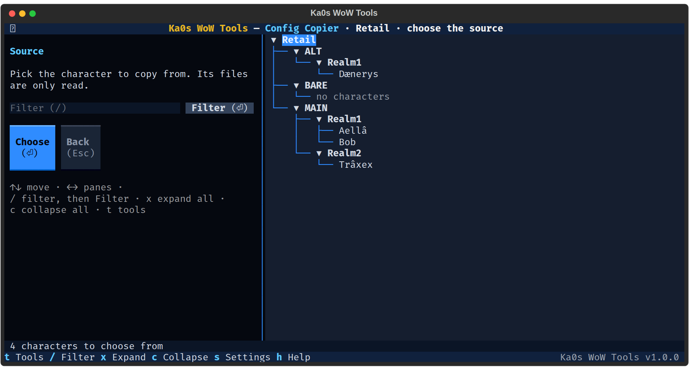
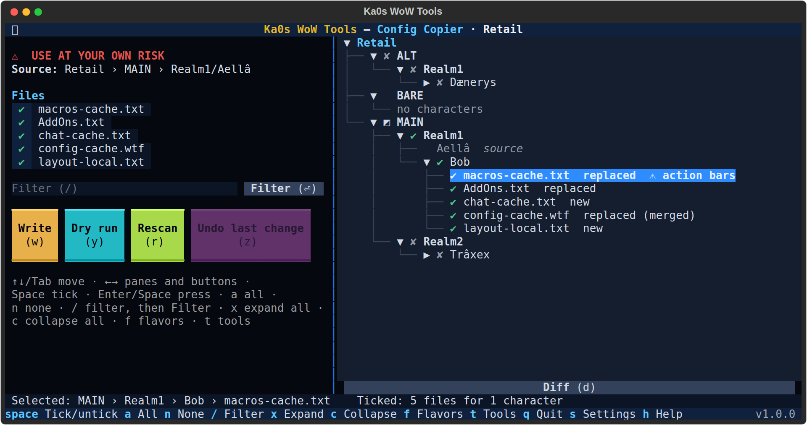

# Config Copier guide

[← Back to the main page](../README.md)

Setting up an alt means making the same macros, picking the same addons, dragging the chat windows into place and
ticking the same options all over again. WoW keeps all of that in a handful of plain files in each character's
folder, so the Config Copier copies them for you: from one character (the **source**) to as many others of the same
game version as you like (the **targets**), in one step you can review and undo.

It copies five files, and nothing else:

| File | Holds |
|---|---|
| `macros-cache.txt` | The character's own macros |
| `AddOns.txt` | Which addons are enabled |
| `chat-cache.txt` | The chat windows and their channels |
| `config-cache.wtf` | The character's CVars (game options); **merged**, see below |
| `layout-local.txt` | The layout of the windows |

Key bindings, click bindings, the Cooldown Manager and Edit Mode are not copied: WoW keeps them on its servers too, and
they depend on the class.

**Close WoW first.** WoW rewrites these files when a character logs out, so a copy made while it runs would be
overwritten. **Write** and **Undo last change** refuse while that game version runs.

## Why a copy sticks

WoW also keeps a copy of most of these files on its servers, and a small file of its own, `cache.md5`, in each
character's folder: a fingerprint of every file it keeps in step with the servers. A copied file no longer matches
its fingerprint, so you might expect WoW to fetch the old one back. It doesn't. In a test with WoW closed, five files
copied from one character to another were all used at the next login (the macros, the chat windows and the options
came across), and at logout WoW wrote new fingerprints for them itself. Nothing came back from the servers.

So the copier only ever copies the plain files. It never touches `cache.md5` or the `.old` files WoW makes beside
them: WoW looks after those.

WoW tidies a little by itself at logout: it may drop tracked quests the character doesn't have and trim its
reputation list. That is WoW, not the copy.

## Step by step

1. Start Ka0s WoW Tools and choose **Config Copier**.
2. **The first time only:** check the backup folder (empty is fine) and press **Save**.
3. **Pick a game version**, or **All flavors**. `t` or `Esc` goes back to the tool menu.
4. **Pick the source**, the character to copy from: highlight it and press Enter or **Choose**. **Back** returns to
   the game versions.
5. The review lists every character. Tick the **targets** (`Space`). Each target opens to its five files and what
   happens to each.
6. Press **Dry run** (`y`) to check everything without writing, or **Write** (`w`), read the summary and press
   **Yes**.
7. The results screen lists every file.



## The review screen



The left pane shows a red `⚠ USE AT YOUR OWN RISK` line (a copy overwrites the targets' files), the source, the five
files (all ticked: untick one to leave it alone for every target), the filter and the buttons. The tree on the right
lists every account, realm and character. The source shows greyed (**source**), and so do the characters of other
game versions (**other flavor**): a copy stays within one game version. Folders that aren't characters, such as
`Bob - Copy`, are not listed.

Nothing is ticked at first. Ticking a character ticks every file it can get; open it to untick a single file. Each
file says what a copy does:

| Status | Means |
|---|---|
| **new** | The target has no such file: it is created |
| **replaced** | The target's file is replaced (**replaced (merged)** for `config-cache.wtf`) |
| **unchanged** | The target already has exactly this: nothing to do |
| **source has no file** | The source has none: the target's file is left alone |
| **can't be read** | The file could not be read: it is never copied, and the **warnings view** lists it |

A replaced `macros-cache.txt` on a character that already has macros shows **⚠ action bars**: see
[Macros and action bars](#macros-and-action-bars).

**Diff** (`d`, under the tree) shows what a replaced file loses (`-` lines) and gets (`+` lines), with three lines
around each change. For `config-cache.wtf` it shows the whole file and notes each line the target keeps
`kept: the target's own` (see [How config-cache.wtf is merged](#how-config-cachewtf-is-merged)). When two files differ
only in their line endings, or in bytes that are not text, the diff says **Only line endings or bytes that are not
text differ.** **Back** (`Esc`) returns to the review. Diff on anything but a replaced file says why it can't.

`/` goes to the filter box: type part of a name and press Enter or **Filter** to see only the characters (and files)
that match. Ticks the filter hides still count, and the bottom line says how many.

### Keys on the review screen

| Key | Does |
|---|---|
| `Space` | Tick or untick the highlighted character or file |
| `a` / `n` | Tick everything shown / nothing |
| `/` | Go to the filter box |
| `x` / `c` | Expand / collapse the whole tree |
| `w` | **Write**: copy the ticked files (asks first) |
| `y` | **Dry run** |
| `r` | **Rescan**: read the files again |
| `z` | **Undo last change** |
| `d` | **Diff** of the highlighted replaced file |
| `!` | Open the files and folders that could not be read (only while there are any; the **⚠ … (!)** button at the bottom does the same) |
| `f` | Back to the game versions |
| `t` | Back to the tool menu |
| `s` | Settings |
| `h` | Help |
| `q` | Quit |

## How config-cache.wtf is merged

`config-cache.wtf` holds two kinds of CVars. **Settings** are what you chose: nameplate distances, Assisted Highlight,
camera options and the like. **Progress and bookkeeping** belong to the character: tracked quests, talent loadouts,
tutorials seen, the last season it saw, which lists are collapsed.

The copy gives the target the source's settings **exactly**: a setting the source has is set to the source's value, and
a setting only the target has is removed. The target keeps its own progress and bookkeeping CVars, and the source's are
never copied. The list of which CVars are progress ships with the app; anything not on it counts as a setting.

A target with no `config-cache.wtf` gets the source's settings only. A setting the target already has with the
source's value is left exactly as it is, so a target that already matches is **unchanged** and never rewritten. Kept
lines stay in the target's order and new ones go at the end; WoW sorts the file again itself at the next logout.

## Macros and action bars

Each macro has a number, and action bar buttons point at that number, not at the macro's name. Copying
`macros-cache.txt` onto a character that already has macros gives it the source's numbers, so its buttons may now
point at a different macro, or at nothing. Such a file shows **⚠ action bars** on the review, and the confirm lists
every one with the warning "Action bar buttons that use macros may need placing again." Place the macros on the bars
again after the copy. A target with no macros has nothing to lose, so it gets no warning.

Only the character's own macros are copied. The account's macros (shared by every character of the account) are in
another file, which the copier leaves alone.

## What the tool never touches

- Any file but the five above, even one with a similar name (`macros-cache - Copy.txt`, `macros-cache.txt.old`).
- WoW's `cache.md5` and `.old` files, and the account folder's files (account macros and settings).
- Key bindings, click bindings, the Cooldown Manager and Edit Mode files.
- Addon settings (`SavedVariables`): the Saved Variables Browser and the Ace3 Profile Manager work on those.
- Folders that aren't characters (`Bob - Copy`, `Bob2`), and characters of another game version.
- The source: it is only read.

## Write

**Write** (`w`) asks first: who is copied where (how many files are replaced and how many new), the targets and
their files in a list, and the macro warnings counted below it. Press **Yes** to copy. Then the copy:

1. backs up the whole `WTF` folder of that game version,
2. zips every file it replaces, as it was,
3. writes each file, checking it reads back exactly as written.

A target file that changed since the review (WoW saved it, say) is skipped, and the results say so; the other files
are still copied. A file the target didn't have is created, but never over one that has appeared since. The results
screen lists every file with what became of it.

## Dry run

**Dry run** (`y`) checks every file in memory, the same way **Write** would, and writes nothing. Its results say what
would be copied. **Back to review** (`Esc`) keeps your ticks.

## Undo last change

**Undo last change** (`z`) puts back every file the last copy replaced and removes every file it created, each only if
WoW hasn't changed it since: a file WoW saved after the copy is left as it is, and the results say so. It asks first,
and takes a backup of the `WTF` folder before it changes anything. Only the last copy can be undone this way; for an
older one, see [Where your backups go](#where-your-backups-go).

## The safety net

Every real copy, Undo and recovery gets the same protection as the other tools that change your settings files:

- a **backup of your whole `WTF` folder** (per game version) before anything is written;
- a **zip of every file it replaces**, as it was, which Undo puts back;
- a **journal**, the record of what was copied, which **Undo last change** reads;
- **a crash marker** while files are being written, so an interrupted copy is noticed (see below);
- the **check of every file** against what the review read, and a read-back after it is written;
- **roll-back**: if a write fails, the files already written in that game version are put back.

### Where your backups go

Unless you change it in settings, the backup folder is `<your WoW folder>\wow-tools`. The tool's files go into its
`config-copier` folder:

```
<backup folder>\config-copier\
  snapshots\snapshot-<flavor>-<YYYYMMDD-HHMMSS>.zip       your whole WTF folder, taken before each copy, undo and recovery
  edited\edited-<flavor>-all-<YYYYMMDD-HHMMSS>.zip         the files a copy replaced, as they were before it
  edit-in-progress.json                                    only while a copy is being written
<your WoW folder>\wow-tools\config-copier\
  journal\journal-<YYYYMMDD-HHMMSS>.jsonl                  the record Undo last change uses
```

`<flavor>` is the game version (`retail`, `classic_era` and so on). If two runs start in the same second, the second
gets `-2` added before `.zip`, so no backup ever replaces another. The journals always stay in your WoW folder, even
if you pick another backup folder.

- Only the newest 10 **WTF backups** (`snapshots`) of each game version are kept: `keep_backups`, a shared setting
  on the first screen `s` opens (`0` keeps them all).
- Only the newest 10 **journals** are kept: `keep_journals`, also shared. An `edited` zip is deleted along with the
  last journal that needs it.
- To put files back by hand (an older copy, say): close WoW, open the `edited\edited-…zip`, and extract it **into
  the game version's folder** (for example `World of Warcraft\_retail_`), keeping the folders. You can ignore
  `manifest.json`. A file the copy created isn't in the zip: delete it by hand if you don't want it.

### If a copy was interrupted

If the app is closed in the middle of a copy (a crash, a power cut, or you closed the window), it notices the next
time the review reads the files and shows **An earlier change did not finish**, with the number of files and where
their originals are. It **never repairs anything on its own**. You choose:

- **Put the originals back**: each file the copy had already written is put back from the zip, and each file it
  created is removed. A file that's neither what it was nor what the copy wrote (WoW saved it since, say) is left as
  it is. This is guarded like Undo: refused while WoW is running, and your `WTF` folder is backed up first.
- **Leave as is**: the files stay as they are now; the zips are kept.

If you close the message with `Esc`, it's shown again at the next scan, and when you press **Write**: a new copy
can't start until you've chosen, since it would lose the way back for the earlier one.

## WoW running

| Action | While WoW runs |
|---|---|
| Pick the source, tick, **Diff** | Fine: nothing is written |
| **Dry run** | Fine: nothing is written |
| **Write**, **Undo last change**, **Put the originals back** | Refused for the game version that is running. Close WoW and try again |

## Settings

Press `s` in the copier (you get the shared settings first, then the copier's). The copier's settings are saved in
`config\config-copier.cfg`.

| Setting | Starts as | What it means |
|---|---|---|
| Backup folder | empty | Where the snapshots and the zips of replaced files go. Empty means `<WoW folder>\wow-tools\config-copier` |

The file itself uses these names, if you edit it by hand: `backup_dir` and `last_flavor_choice`. Close the app
before editing the file, or your change may be overwritten. Comments you add to the file aren't kept (the app
rewrites it when it saves a setting or the game version you pick).

How many snapshots and journals to keep (`keep_backups`, `keep_journals`) are shared by every tool, on the first
screen `s` opens.

## FAQ

| Question | Answer |
|----------|--------|
| Will WoW put my old settings back from its servers? | No. WoW used the copied files at the next login and wrote its own fingerprints (`cache.md5`) for them at logout (see [Why a copy sticks](#why-a-copy-sticks)). |
| Why isn't `cache.md5` copied too? | WoW writes it again itself at the next logout, from the files it finds, and makes its own `.old` files. There is nothing to copy. |
| Can I copy to a character I haven't made yet? | Log in with it once first, so WoW makes its folder. |
| Can I copy between Retail and Classic? | No: a copy stays within one game version. |
| Can I copy account-wide macros and settings? | Not yet: only character files. |
| Why did some tracked quests or reputations change after login? | WoW tidies those itself when the character logs out. |

## Troubleshooting

| Symptom | Fix |
|---------|-----|
| **Write** is greyed out | Tick at least one target with a file that would change. |
| A target is greyed out | It is the source, or a character of another game version. |
| A character is missing | Its folder name isn't a character name (`Bob - Copy`, `Bob2`): rename or remove the folder. |
| A file says **source has no file** | The source character's folder has no such file, so there is nothing to copy. The target's file is left alone. |
| A file was skipped: changed since the review | WoW (or another program) saved it after the review. Press **Rescan** (`r`) and copy again. |
| Action bar buttons are empty after copying macros | Place the macros on the bars again (see [Macros and action bars](#macros-and-action-bars)). |
| Something else looks wrong | Follow [Reporting a bug](../README.md#reporting-a-bug) in the main README. |
