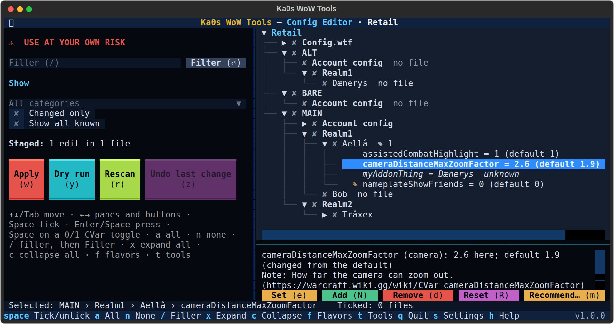
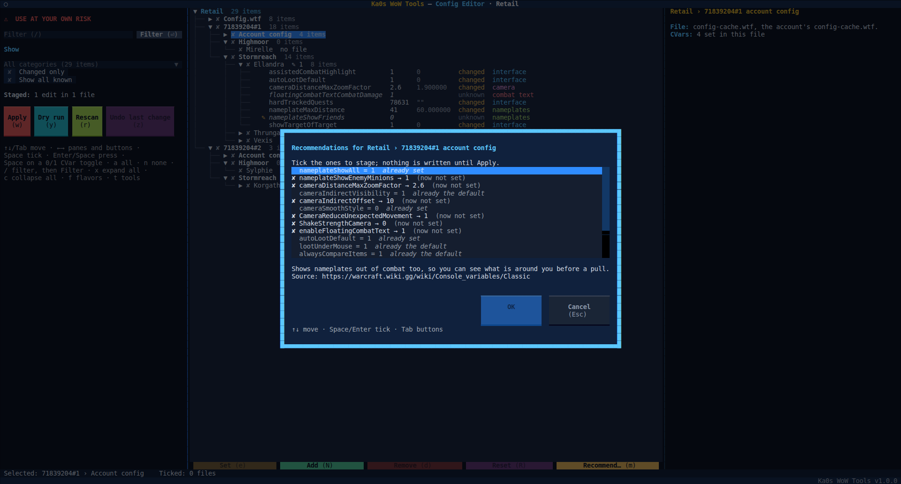

# Config Editor guide

[← Back to the main page](../README.md)

WoW keeps its settings, the CVars, in plain files: `Config.wtf` for this computer, one `config-cache.wtf` for each
account and one in each character's folder. The Config Editor shows all of them in one tree, for every game version
you have installed, explains each CVar, and lets you set, add, remove and reset them, including CVars the game's
menus don't show. Nothing is written until you press **Apply**, and **Undo last change** puts it all back.

**Close WoW first.** WoW rewrites these files when you log out or exit, so a change made while it runs would be
overwritten. **Apply** and **Undo last change** refuse while that game version runs.

The left pane starts with a red `⚠ USE AT YOUR OWN RISK` line: a wrong value can change how the game looks or
plays, and Remove and Reset take lines out of the files.

## The three levels

WoW keeps a CVar in one of three places, and the tree shows all three:

| Line | File | Holds |
|---|---|---|
| **Config.wtf** | `WTF\Config.wtf` | This computer's settings: graphics, sound, the window. Only on this computer |
| **Account config** | `WTF\Account\<account>\config-cache.wtf` | Settings shared by every character of the account |
| a character | `WTF\Account\<account>\<realm>\<character>\config-cache.wtf` | That character's own settings |

Each CVar belongs to one level: the help panel says which (`Kept on this computer`, `per account` or `per character`),
when the game said. **Show all known** lists the CVars of the highlighted file's level. You can still set a CVar in a
file of another level; **Apply** lists it in its summary, since the game may ignore it there.

A file doesn't list every CVar: mostly the ones changed from the game's default. A CVar with no line in a file is
`not set`, and the game uses its default for it.

## Synced CVars and why an edit sticks

WoW also keeps the account and character CVars on Blizzard's servers, so they follow you to another computer; the help
panel says `the game syncs it with Blizzard's servers` for those. Beside each account's and character's
`config-cache.wtf` sits a small file of WoW's own, `cache.md5`: a fingerprint of every file it keeps in step with the
servers. A file you change no longer matches its fingerprint, so you might expect WoW to fetch the old one back. It
doesn't. In a test with WoW closed, a character's `config-cache.wtf` copied from another character was used at the next
login (the other character's options came across), and at logout WoW wrote a new fingerprint for it itself and made its
own `.old` copies. Nothing came back from the servers. `Config.wtf` is never synced: it is only on this computer.

So the editor only ever changes the plain files. It never touches `cache.md5` or the `.old` files: WoW looks after
those.

### If a change comes back

The test above was made on a character's file. The account's file wasn't tested on its own, but WoW keeps it the same
way (the same kind of fingerprint, and a hand-edited account macro file stayed as edited), so the editor treats it
the same. If a CVar you changed is back to its old value after you log in and out (and you didn't change it in the
game), please tell us: follow [Reporting a bug](../README.md#reporting-a-bug) and say which game version, which file
(**Config.wtf**, **Account config** or the character) and which CVar, its old value and the one you set. The editor's
log (`logs\config-editor`) records every file it wrote. **Undo last change** still puts the file back as it was.

## Step by step

1. Start Ka0s WoW Tools and choose **Config Editor**.
2. **The first time only:** check the backup folder (empty is fine) and press **Save**.
3. **Pick a game version**, or **All flavors**. `t` or `Esc` goes back to the tool menu.
4. The tree lists **Config.wtf**, each account's **Account config** and every character. Open one to see its CVars.
5. Highlight a CVar to read about it in the help panel, and change what you like. Each change is marked in the tree;
   nothing is written yet.
6. Press **Dry run** (`y`) to check everything without writing, or **Apply** (`w`), read the summary and press
   **Yes**.
7. The results screen lists every file written.

## The browse screen



The tree lists the [three levels](#the-three-levels) of every game version you picked: **Config.wtf**, then
each account's **Account config** and its characters by realm. Each game version, account and realm, and each file or
character with CVars, says dimmed after its name how many CVars it holds as the filters show them
(`Retail  340 items`, `Aellâ  27 items`; `0 items` when none), even before you open it.

Open a file to see its CVars, one per line in five columns:

```
cameraDistanceMaxZoomFactor     2.6      1.9  changed  camera
floatingCombatTextCombatDamage  not set  1    default  combat text
myAddonThing                    Dænerys       unknown  other
```

- **The CVar's name**, then **its value** in this file: `not set` means the file has no line for it, so the game
  uses its default. A CVar that isn't set is drawn darker than the ones the file sets.
- **The default**: the game's own value, blank when it isn't known.
- **The state**, in colour: `changed` (amber) means the value differs from the default, `default` (green) that it
  matches it or isn't set, `unknown` (grey) that there is no default to compare with: the editor knows nothing about
  that CVar (see [Unknown CVars](#unknown-cvars)) or its list gives no default.
- **The category** (graphics, sound, interface and so on), each in its own colour. **game state** holds what the
  game remembers rather than a setting (popups seen, the last character, renown and transmog trackers), **debug**
  the developer, logging and error CVars, **system** threads, caches, the install and the title bar; **other** only
  what fits nowhere.

The columns line up within each file. A long value (some CVars hold a whole list) is cut with `…` so the state and
category stay in view: the help panel and **Set** show it whole. In a narrow window the value, the default and then
the name are cut further (a long name in its middle, so names that start alike stay apart), and when even that is too
wide the default, the category, the value and then the state are left out: the help panel still shows them. A changed CVar is marked `✎` until **Apply**, and a file with changes shows `✎` and how
many. A character with no file yet says `no file`:
setting a CVar there creates it. Folders that aren't characters, such as `Bob - Copy`, are not listed. A file that can't
be read shows **read-only**: it is never ticked or written, and the **warnings view** lists it.

### The help panel

The panel under the tree (beside it in a window 160 columns wide or more) shows the highlighted CVar, its name in
bold gold at the top, then short sections with a blank line between them and each line's label in bold cyan:

- **Value**, **Default**, **Recommended**, **State** and **Category**: its value here, its default, the
  recommendation for it if there is one, the state (`changed`, `default` or `unknown`, with what that means) and the
  category, both in the colours of their tree columns, and **Type** when it is an on/off switch.
- **Blizzard** and **Note**: Blizzard's own help text and our plain-English note.
- **Scope**: where the game keeps it (this computer, the account or the character) and whether the game syncs it
  with Blizzard's servers. A CVar set in a file of the wrong level (an account CVar in a character's file) gets a
  warning here.
- **Sources**: one bullet for where each of the texts above comes from.

On a file the panel names the file, its level and how many CVars it sets. Scroll the panel with the mouse when it
holds more than fits.

### Where the help comes from

The editor never goes online: everything it knows about CVars ships with it, and every line of it says where it
comes from.

- **Blizzard's help text, the defaults, the levels and whether a CVar is synced** come from the game itself. A small
  addon of ours, run once in each game version, asked the game for its whole CVar list; beside Blizzard's text the
  help panel names the game version and build it was read from (`client dump _retail_ 12.1.5 …`). Retail, Classic, Classic Era and Anniversary
  have their own lists; Forever uses Retail's list for now, and the PTR and Beta have none yet, so their CVars all
  show as `unknown`.
- **Our notes** (`Note:`) are for CVars whose Blizzard text is missing or says little: written in our own words from
  the CVar's page on [warcraft.wiki.gg](https://warcraft.wiki.gg/wiki/Console_variables), with the page's address.
- **The recommendations** each name the page they come from, mostly warcraft.wiki.gg (see [Recommend…](#recommend)).

Nothing is guessed: what the lists don't cover shows as `unknown` or `No description yet.`

### Unknown CVars

A CVar marked `unknown` is one the editor's list has no entry for in that game version: an addon's own CVar, one
the game added after the list was made or took out before it, or any CVar of a game version with no list yet. It has
no help, default or level, so **Reset** refuses it (it says there is no known default; use **Remove** instead) and
**Show all known** doesn't list it; you can still **Set** it, **Remove** it, or **Add** it by name. Check the name before you add one: the game ignores a CVar it
doesn't know.

### Show and search

`/` goes to the filter box: type part of a CVar's name or of its description (or a file's name) and press Enter or
**Filter**; the files with a match open. Under **Show**, pick a category (graphics, sound, interface, camera,
nameplates, combat text, network, game state, debug, system, other: each says how many CVars it would show with the
other choices and the search as they are, `Graphics (22 items)`), tick **Changed only** for the CVars set to something other than their
default, or tick **Show all known** to list every CVar the knowledge base knows for that file's level, set or not.
The search and the **Show** choices narrow the list together: a search you applied earlier still applies when you
pick a category. When the two leave nothing, the help panel says which search and category it is; `Esc` in the
filter box clears the search, and **All categories** shows every category.

### Keys on the browse screen

| Key | Does |
|---|---|
| `Space` | On a CVar that is `0` or `1`: switch it. Elsewhere: tick or untick the highlighted file, character, account or realm |
| `a` / `n` | Tick every file shown / none |
| `/` | Go to the filter box |
| `x` / `c` | Expand / collapse the whole tree |
| `e` | **Set**: a new value for the highlighted CVar |
| `N` | **Add**: a CVar the file doesn't set yet |
| `d` | **Remove**: take the highlighted CVar's line out |
| `R` | **Reset**: back to the default (the line goes) |
| `m` | **Recommend…**: the recommendations for the highlighted file |
| `w` | **Apply**: write every change (asks first) |
| `y` | **Dry run** |
| `r` | **Rescan**: read the files again (asks first when it would drop your changes) |
| `z` | **Undo last change** |
| `!` | Open the files and folders that could not be read (only while there are any; the **⚠ … (!)** button at the bottom does the same) |
| `f` / `Esc` | Back to the game versions |
| `t` | Back to the tool menu |
| `s` | Settings |
| `h` | Help |
| `q` | Quit |

Leaving with changes not applied yet asks first.

## Set, Add, Remove and Reset

**Set**, **Remove** and **Reset** act on the highlighted CVar in every ticked file, or only in its own file when
nothing is ticked: tick your characters, highlight a CVar in one of them and **Set** it, and it is set in all of
them. **Set** shows the default and what the setting does (our note, else Blizzard's text, else "No description in
the reference.") above the value.

**Add** puts a CVar into every ticked file, or the highlighted one. Under the name is a list of every CVar the
knowledge base knows for the file's game version and level that the file (or any of the ticked files) doesn't set
yet; typing narrows it (the first 200 matches show, then how many more). `Enter` picks the highlighted match (the
first, or press `↓` to move into the list and choose another), or click one: its name and its default go into the
fields, and the note under them says what it does and where the game keeps it. Change the value if you like and
press `Enter` or **OK**. A name that isn't in the list can still be typed and added (`Enter` adds it when nothing
matches, **OK** always); the note then says the knowledge base doesn't know it.

**Reset** takes
the line out, since a CVar a file doesn't set takes the game's default; **Remove** does the same for any CVar,
including one with no known default.

## Recommend…



**Recommend…** lists the recommendations for the highlighted file: each with the value, the reason and the page it
comes from. Tick the ones you want (`Space` or `Enter`) and press **OK**; they are staged like any other change.
A recommendation already at its value is listed but can't be ticked (`already set`), and so is one the file doesn't
set whose game default already is that value (`already the default`). Only the recommendations for the file's level
are listed (an account CVar is recommended in **Account config**, not in a character's file).

There are a few dozen, picked by hand for nameplates, the camera, combat text, graphics and the interface, each for
the game versions whose CVar list has it. Each one says why in our own words and links the page it rests on; a
recommendation without a source is never shipped. The help panel shows a CVar's recommendation too.

## Apply

**Apply** (`w`) asks first, with every file and change in a list, and any CVar set in a file of another level than
the one the game keeps it in. Press **Yes** to write. Then it:

1. backs up the whole `WTF` folder of each game version it changes,
2. zips every file it changes as it was,
3. writes each file, checking it reads back as written. Lines you didn't change keep their exact bytes and place;
   new lines go at the end.

A file that changed since it was read (WoW saved it, say) is skipped, and the results say so. With **All flavors**,
one Apply writes every game version in turn, and one **Undo last change** puts them all back.

## Dry run

**Dry run** (`y`) checks every change the same way **Apply** would and writes nothing. Its results say what would be
written. **Back to review** (`Esc`) keeps your changes.

## Undo last change

**Undo last change** (`z`) puts back every file the last Apply changed and removes every file it created, each only
if WoW hasn't changed it since: a file WoW saved after the Apply is left as it is, and the results say so. It asks
first (and first, if changes are waiting, that it will drop them), and takes a backup of the `WTF` folder before it
changes anything. Only the last Apply can be undone this way; for an older one, see
[Where your backups go](#where-your-backups-go).

## What the tool never touches

- Any file but `Config.wtf` and `config-cache.wtf`, even one with a similar name (`config-cache - Copy.wtf`,
  `config-cache.wtf.old`).
- WoW's `cache.md5` and `.old` files.
- A line you didn't change: its bytes and place stay exactly as they were, even in a file it writes.
- Key bindings, macros, chat windows and the other files in a character's folder.
- Folders that aren't characters (`Bob - Copy`, `Bob2`), and files it can't read (read-only).
- Addon settings (`SavedVariables`): the Saved Variables Browser and the Ace3 Profile Manager work on those.

## The safety net

Every real Apply, Undo and recovery gets the same protection as the other tools that change your settings files:

- a **backup of your whole `WTF` folder** (per game version) before anything is written;
- a **zip of every file it changes**, as it was, which Undo puts back;
- a **journal**, the record of what was written, which **Undo last change** reads;
- **a crash marker** while files are being written, so an interrupted Apply is noticed (see below);
- the **check of every file** against what the scan read, and a read-back after it is written;
- **roll-back**: if a write fails, the files already written in that game version are put back, and the game
  versions after it are not started.

### Where your backups go

Unless you change it in settings, the backup folder is `<your WoW folder>\wow-tools`. The tool's files go into its
`config-editor` folder:

```
<backup folder>\config-editor\
  snapshots\snapshot-<flavor>-<YYYYMMDD-HHMMSS>.zip       your whole WTF folder, taken before each Apply, undo and recovery
  edited\edited-<flavor>-all-<YYYYMMDD-HHMMSS>.zip         the files an Apply changed, as they were before it
  edit-in-progress.json                                    only while an Apply is being written
<your WoW folder>\wow-tools\config-editor\
  journal\journal-<YYYYMMDD-HHMMSS>.jsonl                  the record Undo last change uses
```

`<flavor>` is the game version (`retail`, `classic_era` and so on). If two runs start in the same second, the second
gets `-2` added before `.zip`, so no backup ever replaces another. The journals always stay in your WoW folder, even
if you pick another backup folder.

- Only the newest 10 **WTF backups** (`snapshots`) of each game version are kept: `keep_backups`, a shared setting
  on the first screen `s` opens (`0` keeps them all).
- Only the newest 10 **journals** are kept: `keep_journals`, also shared. An `edited` zip is deleted along with the
  last journal that needs it.
- To put files back by hand (an older Apply, say): close WoW, open the `edited\edited-…zip`, and extract it **into
  the game version's folder** (for example `World of Warcraft\_retail_`), keeping the folders. You can ignore
  `manifest.json`. A file the Apply created isn't in the zip: delete it by hand if you don't want it.

### If an Apply was interrupted

If the app is closed in the middle of an Apply (a crash, a power cut, or you closed the window), it notices the next
time it reads the files and shows **An earlier change did not finish**, with the number of files and where their
originals are. It **never repairs anything on its own**. You choose:

- **Put the originals back**: each file the Apply had already written is put back from the zip, and each file it
  created is removed. A file that's neither what it was nor what the Apply wrote (WoW saved it since, say) is left as
  it is. This is guarded like Undo: refused while WoW is running, and your `WTF` folder is backed up first.
- **Leave as is**: the files stay as they are now; the zips are kept.

If you close the message with `Esc`, it's shown again at the next scan, and when you press **Apply**: a new Apply
can't start until you've chosen, since it would lose the way back for the earlier one.

## WoW running

| Action | While WoW runs |
|---|---|
| Browse, search, Set, Add, Remove, Reset, Recommend… | Fine: nothing is written until **Apply** |
| **Dry run** | Fine: nothing is written |
| **Apply**, **Undo last change**, **Put the originals back** | Refused for the game version that is running. Close WoW and try again |

Close WoW before you look, too, if you can: it writes these files when you log out or exit, so what the editor shows
while it runs may be about to change.

## Settings

Press `s` in the editor (you get the shared settings first, then the editor's). The editor's settings are saved in
`config\config-editor.cfg`.

| Setting | Starts as | What it means |
|---|---|---|
| Backup folder | empty | Where the snapshots and the zips of changed files go. Empty means `<WoW folder>\wow-tools\config-editor` |

The file itself uses these names, if you edit it by hand: `backup_dir` and `last_flavor_choice`. Close the app
before editing the file, or your change may be overwritten. Comments you add to the file aren't kept (the app
rewrites it when it saves a setting or the game version you pick).

How many snapshots and journals to keep (`keep_backups`, `keep_journals`) are shared by every tool, on the first
screen `s` opens.

## FAQ

| Question | Answer |
|----------|--------|
| Will the game undo my change from its servers? | No: a file changed with WoW closed is what the game uses at the next login, and WoW writes its own fingerprints (`cache.md5`) for it at logout (see [Synced CVars and why an edit sticks](#synced-cvars-and-why-an-edit-sticks)). If one ever does come back, [tell us](#if-a-change-comes-back). |
| Which file should I change? | The one the help panel says the game keeps the CVar in (this computer, the account or the character). **Show all known** on a file lists the CVars of its level. |
| Is the description right for my game version? | It is the game's own text for that version, or our note from the wiki page it links. Forever uses Retail's list for now (see [Where the help comes from](#where-the-help-comes-from)). |
| What does `unknown` mean? | The editor's list has no entry for that CVar in this game version. You can still change it (see [Unknown CVars](#unknown-cvars)). |
| Is Reset the same as Remove? | Both take the line out, so the game uses its default. Reset is only offered when the default is known: in ticked files of several game versions, it skips the files whose version has no default for it. |

## Troubleshooting

| Symptom | Fix |
|---------|-----|
| **Apply** is greyed out | Nothing is changed yet. |
| Space on a CVar only says to use **Set** | It isn't `0` or `1`: use **Set** (`e`). |
| **Reset** says there is no known default | The CVar is `unknown`, or its game version has no default for it: use **Remove** (`d`) to take the line out. |
| **Recommend…** says there is no recommendation for this file | None is for that file's level and game version: try **Config.wtf** or **Account config**. |
| A file was skipped: changed since it was read | WoW (or another program) saved it after the scan. Press **Rescan** (`r`), make the change again and **Apply**. |
| A change was back after I logged in | Check WoW was closed when you applied it, then [tell us](#if-a-change-comes-back). |
| A character is missing | Its folder name isn't a character name (`Bob - Copy`, `Bob2`): rename or remove the folder. |
| Something else looks wrong | Follow [Reporting a bug](../README.md#reporting-a-bug) in the main README. |
