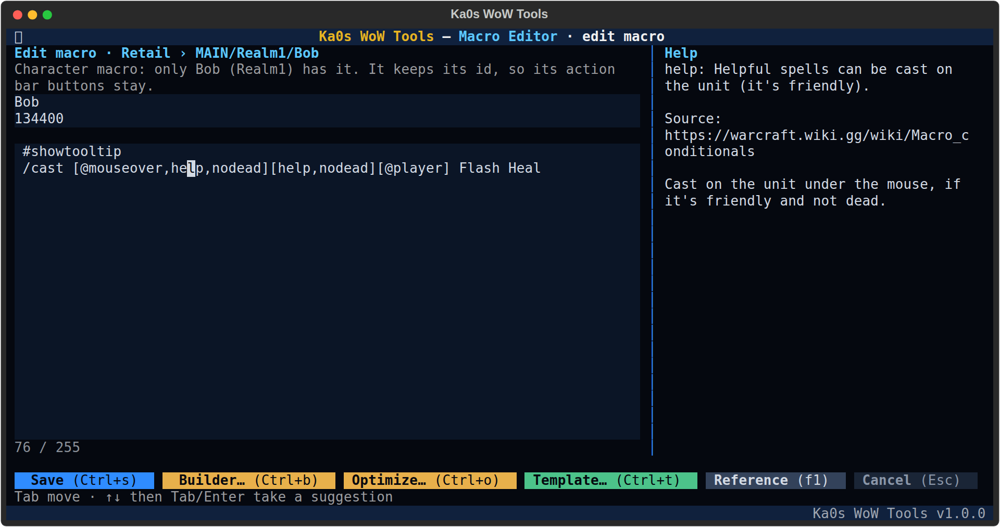

# Macro Editor guide

[← Back to the main page](../README.md)

WoW keeps your macros in plain files: one `macros-cache.txt` for each account's account-wide macros and one in each
character's folder. The Macro Editor shows all of them in one tree, for every game version you have installed, and
lets you edit, create and delete macros, copy them from one character to others (or to another game version), and
find and change text in many macros at once. Its editor suggests and explains commands and conditions as you type,
builds a `[...]` block for you, shortens a macro that is too long and starts new ones from templates. Nothing is
written until you press **Apply**, and **Undo last change** puts it all back.

**Close WoW first.** WoW rewrites these files when a character logs out, so a change made while it runs would be
overwritten. **Apply** and **Undo last change** refuse while that game version runs.

The left pane starts with a red `⚠ USE AT YOUR OWN RISK` line: deleting a macro, or overwriting one with a paste,
removes it, and its action bar buttons with it.

## How WoW keeps your macros

Each account folder has a `macros-cache.txt` with the account's macros (the ones every character of the account
shares), and each character's folder has one with that character's own macros. A file lists every macro with its
number, its name, its icon and its text. A few things about them matter here:

- **Every macro has a number.** Account macros and character macros are numbered separately, and two characters can
  both have a macro number 27. Your action bar buttons point at that number, not at the macro's name.
- **A name holds 16 characters**, as in the game: a longer one is cut (`Celestial Conduit` becomes
  `Celestial Condui`).
- **The icon** is either a number (`134400` is the question mark, which lets the game pick the spell's icon) or a
  texture name such as `INV_Misc_QuestionMark`.
- **WoW sorts them by name when it saves the file**, so a new macro the editor adds at the end shows in its place
  in the game.

WoW also keeps a copy of these files on its servers, and a fingerprint file of its own, `cache.md5`, beside them. An
edited file no longer matches its fingerprint, but WoW uses it all the same at the next login and writes new
fingerprints itself at logout: in a test with WoW closed, hand-edited macro files were kept, and nothing came back
from the servers. So the editor only ever writes `macros-cache.txt`, and never touches `cache.md5` or the `.old`
files WoW makes beside it.

## Macros and action bars

Because a button points at a macro's number, the editor never changes the number of a macro you keep:

- **An edited macro keeps its number**, so its buttons keep working, even when you rename it.
- **A new or pasted macro gets the next free number** in its file (the highest one plus one), so it never takes the
  number of a macro you already have. The game would renumber a clash itself, and a button could then lose its
  macro.
- **Overwrite** in a paste puts the pasted macro's name, icon and text in place of the target's macro and keeps
  the target's number, so the target's buttons now run the pasted macro.
- **A deleted macro's buttons go with it.** The Delete confirm says so: "Action bar buttons that use the deleted
  macros will be removed." The Apply confirm repeats it while a delete is waiting.

A number is never given to a new macro in the same Apply that deletes the old one, so a button can't silently move
from a deleted macro to a new one.

## Slots

The game holds a fixed number of macros: 120 account macros per account and 30 macros per character in Retail.
The editor counts other game versions with Retail's numbers too, which may not be what the game allows there: if the
game refuses a macro in a set the editor shows with room to spare, delete one. The tree shows the slots used (`3/30`), or `30/30 FULL` when no
macro can be added. **New** on a full set says so, and a paste puts in what fits and lists what it leaves out.

## Step by step

1. Start Ka0s WoW Tools and choose **Macro Editor**.
2. **The first time only:** check the backup folder (empty is fine) and press **Save**.
3. **Pick a game version**, or **All flavors**. `t` or `Esc` goes back to the tool menu.
4. The tree lists each account's **Account macros** and every character, with the macro slots used. Open one to see
   its macros.
5. Edit, add, delete, copy and paste as you like. Each change is marked in the tree; nothing is written yet.
6. Press **Dry run** (`y`) to check everything without writing, or **Apply** (`w`), read the summary and press
   **Yes**.
7. The results screen lists every file written.

## The browse screen


Each account shows its **Account macros** and its realms and characters. A character or Account macros line shows
the slots used. Each macro shows its name, its first line and its length (`n/255`: a macro holds 255 characters).
Folders that aren't characters, such as `Bob - Copy`, are not listed.

A change waits in the tree until **Apply**, marked before the macro's line:

| Mark | Means |
|---|---|
| `✎` | Changed (edited, overwritten by a paste or by Replace text…) |
| `+` | New (made with New, or pasted) |
| `✗` | Deleted (struck through) |

A macro file in a layout the editor doesn't know (saved by another program, cut short, or from an older game
version) shows **read-only**: it is never ticked or written, and the **warnings view** lists it.

### Search

`/` goes to the filter box: type part of a name or of a macro's text and press Enter or **Filter**. **Names** and
**Bodies** say what is searched. With **Only matching macros** ticked the tree shows only the macros that match;
untick it to keep every macro in the tree with the matches underlined.

### Keys on the browse screen

| Key | Does |
|---|---|
| `Space` | Tick or untick the highlighted macro, character or Account macros (a character ticks its macros too) |
| `a` / `n` | Tick everything shown / nothing |
| `/` | Go to the filter box |
| `x` / `c` | Expand / collapse the whole tree |
| `N` | **New**: a new macro in the highlighted character or Account macros |
| `e` | **Edit** the highlighted macro |
| `d` | **Delete** the ticked macros, or the highlighted one (asks first) |
| `k` | **Copy** the ticked macros, or the highlighted one |
| `p` | **Paste…** what you copied into the ticked characters and Account macros |
| `R` | **Replace text…** in the ticked macros, or the highlighted one |
| `w` | **Apply**: write every change (asks first) |
| `y` | **Dry run** |
| `r` | **Rescan**: read the files again (asks first when it would drop your changes) |
| `z` | **Undo last change** |
| `!` | Open the files and folders that could not be read (only while there are any; the **⚠ … (!)** button at the bottom does the same) |
| `f` | Back to the game versions |
| `t` | Back to the tool menu |
| `s` | Settings |
| `h` | Help |
| `q` | Quit |

Leaving with changes not applied yet asks first.

## New and Edit

**New** and **Edit** open the edit screen: the macro's name (up to 16 characters, as in the game), its icon (a file
id such as `134400`, the question mark, or a texture name), which set it is in, and its text, with a `n / 255`
meter. **Save** (`Ctrl+S`) is greyed out while the text is too long; it puts the change in the tree, and nothing is
written until **Apply**. An edited macro keeps its place on your action bars.



As you type a `/command`, a conditional after `[` or `,`, or a unit after `@`, a list of suggestions opens under the
text: ↑/↓ choose, Tab or Enter take one, `Esc` closes the list. After a command that is already complete, such as
`/targetenemy`, Enter starts a new line unless you chose a suggestion with ↑/↓. The help panel on the right explains
whatever is under the cursor and reads a whole `[...]` block out in plain English, with the page it comes from: for
`[@mouseover,help,nodead]`, "Cast on the unit under the mouse, if it's friendly and not dead."

### Keys on the edit screen

| Key | What it does |
|---|---|
| `Ctrl+S` | **Save** the macro into the tree |
| `Ctrl+B` | **Builder…**: build the `[...]` block under the cursor, or a new one (see [The conditional builder](#the-conditional-builder)) |
| `Ctrl+O` | **Optimize…**: make the macro shorter (see [The optimizer](#the-optimizer)) |
| `Ctrl+T` | **Template…**: start from a common macro (see [Templates](#templates)) |
| `F1` | **Reference**: every command, conditional and unit the editor knows for this game version, each with its source; **Back** (`Esc`) returns |
| `Esc` | Close the suggestions; with none open, **Cancel**: the macro stays as it was |

The keys use `Ctrl` because the cursor is always in a text box, where a plain letter types.

### The conditional builder

**Builder…** (`Ctrl+B`) opens a window with lists and ticks for a `[...]` block: the **target** (none,
`@mouseover`, `@cursor`, `@focus`, `@target`, `@player`, `@targettarget`), **help**, **harm** or either, and
**states** such as `dead` / `nodead`, `combat` / `nocombat`, `exists`, `mod:shift`, `channeling`, `stealth`,
`mounted`, `flying` and `indoors` / `outdoors`. Opened with the cursor in a block, it starts from that block, and
**OK** rewrites it: what you didn't change stays exactly as you wrote it, and conditions the builder doesn't show
(`spec:2`) are kept. Anywhere else, **OK** puts a new block in at the cursor.

### Templates

**Template…** (`Ctrl+T`) lists ready-made macros. Pick one, fill in its blanks (the spell or item names) and press
**Insert**: it fills an empty macro, or goes in as whole lines after the cursor's line. Each template names the page
it comes from.

| Template |
|---|
| Mouseover heal (falls back to your target) |
| Ground spell at the cursor, no targeting circle |
| Interrupt your focus (or your target when there is no hostile focus) |
| Heal a friendly target, else yourself |
| Stop your own cast, then interrupt |
| Another spell while Shift is held |
| Use your top trinket with a spell |
| Send your pet at the unit under the mouse, else your target, then cast |
| Heal your target, else your target's target, else yourself |
| Flying mount where flying works, else a ground mount; press again to get off |
| Damage a hostile target, heal a friendly one |
| Two spells in turn, starting over on a new target |

### The optimizer

**Optimize…** (`Ctrl+O`) shows every rewrite that makes the macro shorter, before and after, with the reason it
works the same in the game and the page that says so. Nothing changes until **OK**; **Cancel** keeps the macro as it
is. It only makes these rewrites:

| Rewrite | Why it is the same in the game |
|---|---|
| target= to @ | `target=` is the older spelling of `@`: both pick the unit the command acts on |
| Drop a repeated conditional | Every condition in one `[...]` must be true, so the same one twice adds nothing |
| Drop spaces the parser ignores | Spaces inside `[...]`, between blocks and after `;` are ignored when the macro runs |
| #showtooltip without its spell | With no spell named, `#showtooltip` shows the macro's first spell, which is the one it named |

It never swaps `/cast` and `/use`: when a name is both a spell and an item, `/cast` picks the spell and `/use` the
item, so the two are not always the same. It never touches spell names. When there is nothing to shorten it says
so.

### Spell names are not checked

Spell, item and mount names are free text: the editor has no list of spells and never checks or suggests them. A
misspelt spell shows no warning here; the game tells you when you press the button. Its suggestions and help cover
only commands, conditions and units.

## Delete

**Delete** asks first, with the warning that the action bar buttons of the deleted macros will be removed. The
macros show `✗` until **Apply**.

## Copy and paste

1. Tick the macros to copy (or highlight one) and press **Copy** (`k`). The ticks clear.
2. Tick where they go: characters and Account macros, in any game version.
3. Press **Paste…** (`p`). The paste review lists every macro whose name the target already has:
   - **Skip** leaves the target's macro alone (the default),
   - **Rename** pastes it as `Name 2` (cut to 16 characters),
   - **Overwrite** puts the pasted macro in place of the target's, which keeps the target's place on its action bars.

   Choose one by one, or tick **Apply to all**. A set that is full refuses what doesn't fit, and the review says
   which macros won't be pasted.
4. Press **Paste**. The pasted macros show `+` (or `✎` where they overwrite). **Cancel** (`Esc`) drops the paste.

### Across game versions

You can paste between any two game versions, Retail into Classic Era, say. Commands and conditions differ between
them, so the paste review warns, for each pair of versions: "From Retail into Classic Era: a macro written for one
game version may not work in another." Below that it names, macro by macro, each command, condition or unit the
editor's reference says that version doesn't have (`advflyable` is Retail only, for example). Where the reference
doesn't say which versions something works in, it is not named: no line under the warning doesn't mean the macro
works there. The edit screen's help panel names the same terms while you edit a macro in that version.

## Replace text…

**Replace text…** finds text in the ticked macros (or the highlighted one) and replaces it, with **Match case** if
you want: handy for changing a spell name in every macro that uses it. The preview shows each macro before and
after; a macro that would go over 255 characters is left out. Names are not changed. **Replace** puts the changes
in the tree like any other edit.

## Apply

**Apply** (`w`) asks first, with every file and change in a list (and the action bar warning while a delete is
waiting). Press **Yes** to write. Then it:

1. backs up the whole `WTF` folder of each game version it changes,
2. zips every file it changes as it was,
3. writes each file, checking it reads back as written. Macros you didn't change keep their exact bytes.

A file that changed since it was read (WoW saved it, say) is skipped, and the results say so. With **All flavors**,
one Apply writes every game version in turn, and one **Undo last change** puts them all back.

## Dry run

**Dry run** (`y`) checks every change the same way **Apply** would and writes nothing. Its results say what would be
written. **Back to review** (`Esc`) keeps your changes.

## Undo last change

**Undo last change** (`z`) puts back every file the last Apply changed and removes every file it created, each only
if WoW hasn't changed it since: a file WoW saved after the Apply is left as it is, and the results say so. It asks
first (and first, if changes are waiting, that it will drop them), and takes a backup of the `WTF` folder before it
changes anything. Only the last Apply can be undone this way; for an older one, see
[Where your backups go](#where-your-backups-go).

## What the tool never touches

- Any file but `macros-cache.txt`, even one with a similar name (`macros-cache - Copy.txt`, `macros-cache.txt.old`).
- WoW's `cache.md5` and `.old` files.
- Key bindings, click bindings and the action bars themselves: it changes macros, not where they sit.
- A macro you didn't change: its bytes stay exactly as they were, even in a file it writes.
- Folders that aren't characters (`Bob - Copy`, `Bob2`), and files in a layout it doesn't know (read-only).
- Addon settings (`SavedVariables`): the Saved Variables Browser and the Ace3 Profile Manager work on those.

## The safety net

Every real Apply, Undo and recovery gets the same protection as the other tools that change your settings files:

- a **backup of your whole `WTF` folder** (per game version) before anything is written;
- a **zip of every file it changes**, as it was, which Undo puts back;
- a **journal**, the record of what was written, which **Undo last change** reads;
- **a crash marker** while files are being written, so an interrupted Apply is noticed (see below);
- the **check of every file** against what the scan read, and a read-back after it is written;
- **roll-back**: if a write fails, the files already written in that game version are put back, and the game
  versions after it are not started.

### Where your backups go

Unless you change it in settings, the backup folder is `<your WoW folder>\wow-tools`. The tool's files go into its
`macro-editor` folder:

```
<backup folder>\macro-editor\
  snapshots\snapshot-<flavor>-<YYYYMMDD-HHMMSS>.zip       your whole WTF folder, taken before each Apply, undo and recovery
  edited\edited-<flavor>-all-<YYYYMMDD-HHMMSS>.zip         the files an Apply changed, as they were before it
  edit-in-progress.json                                    only while an Apply is being written
<your WoW folder>\wow-tools\macro-editor\
  journal\journal-<YYYYMMDD-HHMMSS>.jsonl                  the record Undo last change uses
```

`<flavor>` is the game version (`retail`, `classic_era` and so on). If two runs start in the same second, the second
gets `-2` added before `.zip`, so no backup ever replaces another. The journals always stay in your WoW folder, even
if you pick another backup folder.

- Only the newest 10 **WTF backups** (`snapshots`) of each game version are kept: `keep_backups`, a shared setting
  on the first screen `s` opens (`0` keeps them all).
- Only the newest 10 **journals** are kept: `keep_journals`, also shared. An `edited` zip is deleted along with the
  last journal that needs it.
- To put files back by hand (an older Apply, say): close WoW, open the `edited\edited-…zip`, and extract it **into
  the game version's folder** (for example `World of Warcraft\_retail_`), keeping the folders. You can ignore
  `manifest.json`. A file the Apply created isn't in the zip: delete it by hand if you don't want it.

### If an Apply was interrupted

If the app is closed in the middle of an Apply (a crash, a power cut, or you closed the window), it notices the next
time it reads the files and shows **An earlier change did not finish**, with the number of files and where their
originals are. It **never repairs anything on its own**. You choose:

- **Put the originals back**: each file the Apply had already written is put back from the zip, and each file it
  created is removed. A file that's neither what it was nor what the Apply wrote (WoW saved it since, say) is left as
  it is. This is guarded like Undo: refused while WoW is running, and your `WTF` folder is backed up first.
- **Leave as is**: the files stay as they are now; the zips are kept.

If you close the message with `Esc`, it's shown again at the next scan, and when you press **Apply**: a new Apply
can't start until you've chosen, since it would lose the way back for the earlier one.

## WoW running

| Action | While WoW runs |
|---|---|
| Browse, search, edit, copy, paste, Replace text… | Fine: nothing is written until **Apply** |
| **Dry run** | Fine: nothing is written |
| **Apply**, **Undo last change**, **Put the originals back** | Refused for the game version that is running. Close WoW and try again |

## Settings

Press `s` in the editor (you get the shared settings first, then the editor's). The editor's settings are saved in
`config\macro-editor.cfg`.

| Setting | Starts as | What it means |
|---|---|---|
| Backup folder | empty | Where the snapshots and the zips of changed files go. Empty means `<WoW folder>\wow-tools\macro-editor` |

The file itself uses these names, if you edit it by hand: `backup_dir` and `last_flavor_choice`. Close the app
before editing the file, or your change may be overwritten. Comments you add to the file aren't kept (the app
rewrites it when it saves a setting or the game version you pick).

How many snapshots and journals to keep (`keep_backups`, `keep_journals`) are shared by every tool, on the first
screen `s` opens.

## FAQ

| Question | Answer |
|----------|--------|
| Will my action bars still work after an edit? | Yes: an edited or overwritten macro keeps its number, and the buttons point at the number (see [Macros and action bars](#macros-and-action-bars)). A deleted one's buttons go. |
| Will WoW put my old macros back from its servers? | No. WoW uses the edited file at the next login and writes its own fingerprints (`cache.md5`) for it at logout. |
| Can I copy macros from Retail to Classic? | Yes; the paste review warns that they may not work there and names what that version may not have (see [Across game versions](#across-game-versions)). |
| Does it check my spell names? | No. Spell names are free text (see [Spell names are not checked](#spell-names-are-not-checked)). |
| My new macro is at the end of the list. Will it stay there? | No: WoW sorts the macros by name when it saves the file. |
| Why was my long name cut? | The game holds 16 characters per name. |
| Why is a character's macro file read-only? | It isn't in the layout the editor knows; it is shown but never written. |

## Troubleshooting

| Symptom | Fix |
|---------|-----|
| **Apply** is greyed out | Nothing is changed yet. |
| **Save** is greyed out | The macro is over 255 characters: shorten it, or try **Optimize…** (`Ctrl+O`). |
| **New** says there is no free slot | The set is full (`30/30 FULL`): delete a macro first, or put it in Account macros. |
| **Paste…** says to tick the sets first | Tick the characters or Account macros to paste into. |
| A pasted macro was left out | The target set was full; the paste review lists them. |
| A file was skipped: changed since it was read | WoW (or another program) saved it after the scan. Press **Rescan** (`r`), make the change again and **Apply**. |
| An action bar button is empty after Apply | Its macro was deleted. Drag another macro onto the bar. |
| A character is missing | Its folder name isn't a character name (`Bob - Copy`, `Bob2`): rename or remove the folder. |
| Something else looks wrong | Follow [Reporting a bug](../README.md#reporting-a-bug) in the main README. |
