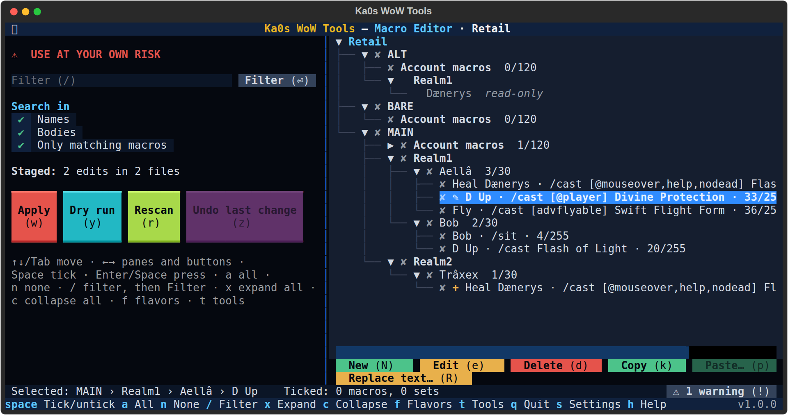

# Macro Editor guide

[← Back to the main page](../README.md)

WoW keeps your macros in plain files: one `macros-cache.txt` for each account's account-wide macros and one in each
character's folder. The Macro Editor shows all of them in one tree, for every game version you have installed, and
lets you edit, create and delete macros, copy them from one character to others (or to another game version), and
find and change text in many macros at once. Nothing is written until you press **Apply**, and **Undo last change**
puts it all back.

**Close WoW first.** WoW rewrites these files when a character logs out, so a change made while it runs would be
overwritten. **Apply** and **Undo last change** refuse while that game version runs.

The left pane starts with a red `⚠ USE AT YOUR OWN RISK` line: deleting a macro, or overwriting one with a paste,
removes it, and its action bar buttons with it.

## Step by step

1. Start Ka0s WoW Tools and choose **Macro Editor**.
2. **The first time only:** check the backup folder (empty is fine) and press **Save**.
3. **Pick a game version**, or **All flavors**. `t` or `Esc` goes back to the tool menu.
4. The tree lists each account's **Account macros** and every character, with the macro slots used. Open one to see
   its macros.
5. Edit, add, delete, copy and paste as you like. Each change is marked in the tree; nothing is written yet.
6. Press **Dry run** (`y`) to check everything without writing, or **Apply** (`w`), read the summary and press
   **Yes**.
7. The results screen lists every file written.

## The browse screen

Each account shows its **Account macros** and its realms and characters. A character or Account macros line shows
the slots used: `3/30`, or `30/30 FULL` when no macro can be added. Each macro shows its name, its first line and
its length (`n/255`: a macro holds 255 characters). Folders that aren't characters, such as `Bob - Copy`, are not
listed.

A change waits in the tree until **Apply**, marked before the macro's line:

| Mark | Means |
|---|---|
| `✎` | Changed (edited, overwritten by a paste or by Replace text…) |
| `+` | New (made with New, or pasted) |
| `✗` | Deleted (struck through) |

A macro file in a layout the editor doesn't know shows **read-only**: it is never ticked or written, and the
**warnings view** lists it.

### Search

`/` goes to the filter box: type part of a name or of a macro's text and press Enter or **Filter**. **Names** and
**Bodies** say what is searched. With **Only matching macros** ticked the tree shows only the macros that match;
untick it to keep every macro in the tree with the matches underlined.

### Keys on the browse screen

| Key | Does |
|---|---|
| `Space` | Tick or untick the highlighted macro, character or Account macros (a character ticks its macros too) |
| `a` / `n` | Tick everything shown / nothing |
| `/` | Go to the filter box |
| `x` / `c` | Expand / collapse the whole tree |
| `N` | **New**: a new macro in the highlighted character or Account macros |
| `e` | **Edit** the highlighted macro |
| `d` | **Delete** the ticked macros, or the highlighted one (asks first) |
| `k` | **Copy** the ticked macros, or the highlighted one |
| `p` | **Paste…** what you copied into the ticked characters and Account macros |
| `R` | **Replace text…** in the ticked macros, or the highlighted one |
| `w` | **Apply**: write every change (asks first) |
| `y` | **Dry run** |
| `r` | **Rescan**: read the files again (asks first when it would drop your changes) |
| `z` | **Undo last change** |
| `!` | Open the files and folders that could not be read (only while there are any; the **⚠ … (!)** button at the bottom does the same) |
| `f` | Back to the game versions |
| `t` | Back to the tool menu |
| `s` | Settings |
| `h` | Help |
| `q` | Quit |

Leaving with changes not applied yet asks first.

## New and Edit

**New** and **Edit** open a form with the macro's name (up to 16 characters, as in the game), its icon (a file id
such as `134400`, the question mark, or a texture name) and its text, with a `n / 255` meter. **Save** is greyed out
while the text is too long. An edited macro keeps its place on your action bars.

## Delete

**Delete** asks first. Action bar buttons point at a macro, so the buttons of a deleted macro go with it.

## Copy and paste

1. Tick the macros to copy (or highlight one) and press **Copy** (`k`). The ticks clear.
2. Tick where they go: characters and Account macros, in any game version.
3. Press **Paste…** (`p`). The paste review lists every macro whose name the target already has:
   - **Skip** leaves the target's macro alone (the default),
   - **Rename** pastes it as `Name 2`,
   - **Overwrite** puts the pasted macro in place of the target's, which keeps the target's place on its action bars.

   Choose one by one, or tick **Apply to all**. A set that is full refuses what doesn't fit, and the review says
   which macros won't be pasted.
4. Press **Paste**. The pasted macros show `+` (or `✎` where they overwrite).

Pasting into another game version works, but the review warns that the macro may not work there and names any
command or condition that version may not have.

## Replace text…

**Replace text…** finds text in the ticked macros (or the highlighted one) and replaces it, with **Match case** if
you want. The preview shows each macro before and after; a macro that would go over 255 characters is left out.
Names are not changed.

## Apply

**Apply** asks first, with every file and change in a list. Then it:

1. backs up the whole `WTF` folder of each game version it changes (`snapshots\snapshot-<flavor>-<YYYYMMDD-HHMMSS>.zip`),
2. zips every file it changes as it was (`edited\...`),
3. writes each file, checking it reads back as written. Macros you didn't change keep their exact bytes.

A file that changed since it was read (WoW saved it) is skipped, and the results say so. WoW's own `cache.md5` and
`.old` files are never touched.

## Dry run

**Dry run** checks every change without writing anything. **Back to review** (`Esc`) keeps your changes.

## Undo last change

**Undo last change** (`z`) puts back every file the last Apply changed and removes every file it created, each only
if WoW hasn't changed it since. The journal of each Apply is kept under
`<WoW folder>\wow-tools\macro-editor\journal\`.

If the app stops in the middle of an Apply (a crash, a power cut), the next scan says so and offers **Put the
originals back** or **Leave as is**.

## Settings

Press `s` in the editor (you get the shared settings first, then the editor's). The editor's settings are saved in
`config\macro-editor.cfg`.

| Setting | Starts as | What it means |
|---|---|---|
| Backup folder | empty | Where the snapshots and the zips of changed files go. Empty means `<WoW folder>\wow-tools\macro-editor` |

The file itself uses these names, if you edit it by hand: `backup_dir` and `last_flavor_choice`. Close the app
before editing the file, or your change may be overwritten. Comments you add to the file aren't kept (the app
rewrites it when it saves a setting or the game version you pick).

How many snapshots and journals to keep (`keep_backups`, `keep_journals`) are shared by every tool, on the first
screen `s` opens.

## FAQ

| Question | Answer |
|----------|--------|
| Will my action bars still work after an edit? | Yes: an edited or overwritten macro keeps its place. A deleted one's buttons go. |
| Can I copy macros from Retail to Classic? | Yes; the paste review warns about what may not work there. |
| Why is a character's macro file read-only? | It isn't in the layout the editor knows; it is shown but never written. |

## Troubleshooting

| Symptom | Fix |
|---------|-----|
| **Apply** is greyed out | Nothing is changed yet. |
| **Paste…** says to tick the sets first | Tick the characters or Account macros to paste into. |
| A character is missing | Its folder name isn't a character name (`Bob - Copy`, `Bob2`): rename or remove the folder. |
| Something else looks wrong | Follow [Reporting a bug](../README.md#reporting-a-bug) in the main README. |
